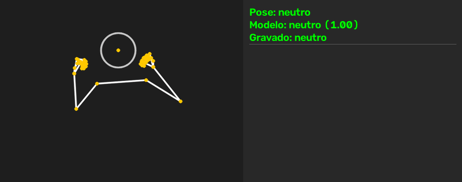

# meme-pose

Rastreia a pose pela webcam e mostra um meme quando reconhece uma pose conhecida. Faça a mão de rock e aparece o meme de rock; junte as palmas e aparece o "amém". São 12 poses mais o `neutro`, reconhecidas em CPU comum, em tempo real.



_O boneco é reconstruído a partir de uma sessão gravada, sem câmera e sem rosto. O MLP do GIF foi treinado sem essa sessão, então ele mostra previsões numa sessão que o modelo nunca viu. O painel tem três linhas:_
- _"Modelo": o palpite do classificador e a confiança dele._
- _"Pose": o que o app aceita. Abaixo de 0,8 de confiança, o palpite vira `neutro`, e o estabilizador espera a nova pose se firmar antes de trocar._
- _"Gravado": o rótulo verdadeiro._

_Para gerar de novo: `python -m scripts.demo_gif`._

Os memes vêm de uma pasta local e são associados às poses sem treino, pelo CLIP. Para incluir um meme novo, basta colocar a imagem em `memes/`. As 12 poses, com o gesto de cada uma, estão no [guia de gravação](docs/gravacao.md#poses).

## Destaques

- **92% de acurácia em sessões que o modelo nunca viu:** avaliação por sessão (leave-one-session-out), comparada com KNN e com regras geométricas.
- **Cerca de 29 FPS em CPU comum:** pose e mãos rodam em paralelo, e classificação, estabilização e render somam cerca de 2 ms por frame.
- **Memes associados às poses sem treino:** CLIP zero-shot, só na indexação e com cache. Para incluir um meme, basta colocar a imagem na pasta.
- **Decisões de ML medidas e explicadas:**
  - split por sessão, contra o vazamento entre frames;
  - uma única fonte de features, contra o training-serving skew;
  - espelhamento só no treino, de 0,874 para 0,922;
  - limitações declaradas.
- **Engenharia:**
  - 436 testes unitários sem câmera e sem baixar modelos, rodando no CI do GitHub Actions;
  - config validado;
  - checklist reproduzível para adicionar poses (`/nova-pose`).

**Stack:** Python 3.12, MediaPipe Tasks (pose e mãos), OpenCV, scikit-learn (MLP), sentence-transformers (CLIP), NumPy e pytest.

## Como funciona

```
câmera → tracker → features → classificador → estabilizador → memes → render → janela
```

| Etapa | Módulo | O que faz |
|---|---|---|
| tracker | `pose_meme/tracker.py` | MediaPipe `PoseLandmarker` (tronco e braços) e `HandLandmarker` (21 pontos por mão), em paralelo |
| features | `pose_meme/features.py` | vetor de 125 valores, normalizado pelo corpo (veja [Decisões](#decisões)) |
| classificador | `pose_meme/classifier.py` | MLP do scikit-learn; regras geométricas quando não há modelo treinado |
| estabilizador | `pose_meme/stabilizer.py` | a pose só muda quando uma classe domina 70% dos últimos 8 frames |
| memes | `pose_meme/meme_index.py` | embeddings do CLIP calculados na indexação e guardados em cache; no loop, só uma consulta a um dicionário |
| render | `pose_meme/renderer.py` | esqueleto sobre a câmera e painel ao lado: pose, confiança, FPS e estado do som em cima, meme embaixo, sem esticar a imagem |
| som | `pose_meme/sound.py` | um plim curto quando um meme aparece, gerado por código e tocado sem travar o loop |

O `main.py` só liga as etapas. Coleta (`scripts/collect.py`), treino (`scripts/train.py`) e app usam o mesmo `features.py`.

## Resultados

### Classificador

Três sessões gravadas em dias diferentes, 7400 amostras. Cada sessão é testada por um modelo que não a viu (leave-one-session-out), e as métricas somam as três.

| Classificador | Acurácia | F1 macro | Pior sessão | Meme indevido em `neutro` | Latência |
|---|---|---|---|---|---|
| **MLP** (o modelo salvo) | **0,922** | **0,921** | **0,872** | **0,165** | 0,30 ms |
| KNN (baseline) | 0,813 | 0,813 | 0,764 | 0,198 | 2,30 ms |
| Regras (baseline) | 0,720 | 0,688 | 0,673 | 0,255 | 0,03 ms |

MLP e KNN treinam também com cópias espelhadas das sessões de treino (veja [Decisões](#decisões)).

- **"Meme indevido em `neutro`"** é a fração de frames sem pose em que o app mostraria um meme, ou seja, o erro que o usuário mais percebe.
- **As classes mais fracas** são:
  - `garras_para_frente` (F1 0,80), que se confunde com `maos_abertas_para_frente`;
  - `neutro` (F1 0,81), com 75% de recall.
- **O relatório completo**, com a matriz de confusão por classificador, está em [reports/report.md](reports/report.md).

**Por que três sessões:** com só duas, o MLP fazia 0,533 de acurácia e ficava abaixo das regras.
- **O que mudou:** as duas sessões tinham gravado o `neutro` de jeitos diferentes, uma sem mãos visíveis e a outra com. Cada modelo aprendia um `neutro` que a sessão de teste não tinha, e o recall do `neutro` ficava em 0.
- **O que isso mostra:** o split aleatório nunca teria revelado o problema, como explica a seção [Decisões](#decisões).

### Memes

Nos 12 memes do repositório, comparei a classe do CLIP com a associação feita à mão:

| Modelo | Prompt por classe | Acertos |
|---|---|---|
| `clip-ViT-B-32` | um | 7/12 |
| `clip-ViT-L-14` | média de 4 templates | 9/12 |

- **Os 3 erros do L-14** perdem por menos de 0,01 de similaridade e foram corrigidos em `memes.overrides`.
- **Os números são otimistas:** a mesma amostra de 12 memes serviu para escolher o modelo e para medir.
- **A indexação** leva 41 s com o modelo, e 0,5 s quando o cache está em dia.

### Desempenho

Medido só em CPU (a GPU não é usada), com uma câmera de 1280x720 a 30 FPS, rodando `python main.py`, que imprime esta tabela ao fechar e descarta os primeiros 60 frames. Cerca de 2000 frames por modelo.

| Etapa | `full`: média (ms) | `full`: p95 (ms) | `lite`: média (ms) | `lite`: p95 (ms) |
|---|---|---|---|---|
| capture | 4,42 | 6,60 | 5,09 | 8,85 |
| tracking (pose + mãos) | 26,28 | 35,33 | 25,17 | 33,97 |
| features | 0,15 | 0,19 | 0,15 | 0,19 |
| classifier (MLP) | 0,54 | 0,67 | 0,55 | 0,70 |
| stabilizer+meme | 0,02 | 0,02 | 0,02 | 0,02 |
| render | 1,44 | 1,80 | 1,42 | 1,79 |
| display | 2,03 | 2,44 | 2,02 | 2,41 |
| **total** | **34,87 (28,7 FPS)** | | **34,42 (29,1 FPS)** | |

- **O tracking é o gargalo:** ocupa três quartos do frame. Features, classificação e estabilização somam menos de 1 ms.
- **O `lite` não compensa:** ganha só 1 ms. Pose e mãos rodam em paralelo, então o tracking dura o que demora o mais lento dos dois, e o modelo de mãos é o mesmo nas duas variantes. Por isso o padrão continua `full`, que é mais preciso.
- **O app chega perto dos 30 FPS da câmera:** o `capture` inclui a espera pelo próximo frame, então nenhuma otimização passaria de uns 33 ms por frame.
- **O render caiu de 7,1 para 1,4 ms**, com o p95 de 19,9 para 1,8 ms. Antes, o meme com transparência era misturado ao painel a cada frame. Agora o painel com o meme é montado só quando o meme muda, e a imagem da janela é reaproveitada.

## Decisões

**Split por sessão, nunca aleatório.**
- **O problema:** frames consecutivos são quase idênticos. Num split aleatório, cada frame de teste tem um "gêmeo" no treino, e a acurácia mede memorização.
- **Como avalio:** cada amostra carrega o `session_id`, e a avaliação é leave-one-session-out: cada sessão é testada por um modelo treinado nas outras.
- **Por que importa:** foi esse split que expôs o problema do `neutro` descrito acima.

**Uma única fonte de features, contra o training-serving skew.**
- **O risco:** se a coleta e o app calculassem as features de jeitos diferentes, o modelo seria avaliado num formato e usado em outro, sem nenhum erro aparente.
- **Como evito:** o `features.py` é o único que transforma landmarks em vetor, e coleta, treino e app chamam a mesma função.
- **O custo:** os CSVs guardam o vetor, não os landmarks. Mudar as features exige gravar de novo ou reaplicar a mudança aos vetores guardados.

**Features invariantes à posição, à distância e ao tamanho do frame.**
- **Normalização:**
  1. o x é corrigido pela proporção do frame, porque o MediaPipe normaliza cada eixo separadamente;
  2. a origem vai para o centro dos ombros;
  3. tudo é dividido pela distância entre os ombros.
- **Associação das mãos:** cada mão vai para o punho da pose mais próximo, e não pelo rótulo esquerda/direita do modelo, que falha em frame espelhado.
- **Mão não detectada:** não descarta a amostra. O vetor mantém o tamanho e leva um indicador de presença.

**Aumento de dados por espelhamento, só no treino.**
- **A ideia:** cada amostra de treino ganha uma cópia espelhada. O x muda de sinal e os pontos e mãos de um lado trocam com os do outro. Assim, uma pose gravada mais com a mão direita também ensina a esquerda.
- **O cuidado:** só os dados de treino de cada fold são espelhados. A sessão de teste é avaliada como foi gravada, e nenhuma cópia dela entra no treino; um teste garante isso. A função `mirror_features` fica no `features.py`, que é o único lugar que conhece o layout do vetor.
- **O efeito**, nas mesmas três sessões e nos mesmos frames de teste:

  | | Sem espelhamento | Com espelhamento |
  |---|---|---|
  | Acurácia do MLP | 0,874 | 0,922 |
  | Pior sessão | 0,791 | 0,872 |

  - **Maiores ganhos:** foram nas poses de uma mão: `mao_na_gravata` (+0,16 de F1), `dedo_na_boca` (+0,14) e `sinal_de_rock` (+0,10).
  - **O custo:** o meme indevido em `neutro` subiu de 0,157 para 0,165.

**Pose e mãos em paralelo.** Em sequência, os dois modelos do MediaPipe passam do orçamento de um frame a 30 FPS.

**Classe `neutro`, threshold e estabilizador.**
- **Classe `neutro`:** o classificador sempre escolhe alguma classe, então o "nenhuma pose" é uma classe treinada como as outras.
- **Threshold:** um meme só aparece com confiança de pelo menos 0,8.
- **Estabilizador:** a pose só muda quando se sustenta por vários frames. O meme é sorteado na troca de pose e fica enquanto ela durar.

**O MLP é sempre o modelo salvo.**
- **Os baselines:** KNN e regras servem de comparação.
- **Por quê:** como o resultado não escolhe o modelo, a avaliação mede o MLP em vez de servir para escolhê-lo.
- **Regras como fallback:** elas também funcionam sem modelo treinado.

**CLIP só na indexação.**
- **Onde roda:** o CLIP não roda no loop de frames.
- **Cache:** os embeddings ficam em `data/cache/`, invalidados pelo hash da pasta `memes/` mais o nome do modelo. O app reindexa ao abrir se algo mudou.
- **Atribuição:** cada meme vai para a classe de prompt mais similar (cosseno). O embedding da classe é a média de 4 templates.
- **Por que o L-14:** o B-32 não diferencia gestos finos de mão (7/12). Como o CLIP não roda durante o uso, o modelo maior não custa FPS.

## Limitações

- **Uma pessoa só:** todas as sessões são do mesmo usuário. A acurácia em outras pessoas não foi medida.
- **Mão fantasma:** o `HandLandmarker` às vezes detecta uma mão inexistente perto do ombro. Isso ocorreu em 41 frames de `mao_na_gravata` da `sessao_04`. Um corte simples por distância ao punho não resolve, porque também descartaria mãos reais.
- **`min_similarity` não separa memes de imagens sem pessoa:** imagens sem pessoa pontuam de 0,145 a 0,197, e os memes de 0,178 a 0,240, então as faixas se sobrepõem. O limite de 0,16 só descarta ruído e formas simples.
- **Sessão incompleta:** a `sessao_02` não tem as duas poses criadas depois dela (`maos_na_cabeca` e `mao_na_gravata`).

## Setup

Requer Windows nativo (o WSL2 não acessa a webcam por padrão) e Python 3.11 ou 3.12. Tudo roda em CPU: o MediaPipe usa o delegate padrão de CPU, e o `torch` instalado pelo `requirements.txt` é a versão sem CUDA. Uma GPU, se houver, não é usada.

```powershell
py -3.12 -m venv .venv
.venv\Scripts\activate
pip install -r requirements.txt
```

### Baixar os modelos

Os arquivos `.task` não são versionados. Baixe o modelo de pose `full`, que é o padrão, e o de mãos:

```powershell
Invoke-WebRequest -Uri https://storage.googleapis.com/mediapipe-models/pose_landmarker/pose_landmarker_full/float16/latest/pose_landmarker_full.task -OutFile models\pose_landmarker_full.task
Invoke-WebRequest -Uri https://storage.googleapis.com/mediapipe-models/hand_landmarker/hand_landmarker/float16/latest/hand_landmarker.task -OutFile models\hand_landmarker.task
```

Para usar a pose `lite` ou `heavy`, troque `full` nos três pontos do primeiro comando e ajuste `tracker.model_variant` no `config.yaml`.

O CLIP (cerca de 1,6 GB) é baixado sozinho na primeira indexação.

## Uso

```powershell
python main.py
```

| Tecla | Ação |
|---|---|
| `q` | fecha o app e imprime os tempos por etapa |
| `s` | liga/desliga o esqueleto |
| `m` | liga/desliga o som |

Quando um meme aparece, toca um plim curto, o mesmo para todos os memes. Ele toca uma vez por aparição e no máximo a cada 1,5 s, para trocas rápidas de pose não virarem uma sequência de plins. O volume, o intervalo e se o app já abre com som ficam na seção `sound` do `config.yaml`. O som usa o `winsound`, da biblioteca padrão do Windows.

## Memes

Coloque as imagens em `memes/` (`.png`, `.webp`, `.jpg` ou `.jpeg`). Cada uma vai para a pose de prompt mais parecido no `config.yaml`. O app reindexa sozinho ao abrir quando a pasta muda. Para ver a classe e a margem de cada meme:

```powershell
python -m scripts.index_memes
```

Se um meme cair na pose errada, corrija em `memes.overrides`, no `config.yaml`. Uma margem pequena, perto de 0,01, indica que o CLIP ficou em dúvida entre duas classes.

As imagens em `memes/` são memes conhecidos, de figuras públicas e imagens virais. Os direitos pertencem aos respectivos autores. Elas estão aqui só para demonstração, sem fins comerciais, e podem ser removidas a pedido.

## Treinar o classificador

O app usa o modelo treinado em `models/pose_clf.joblib` se ele existir, e as regras geométricas se não existir.

**1. Grave pelo menos duas sessões**, em condições diferentes (luz, roupa, distância):

```powershell
python -m scripts.collect
```

| Tecla | Ação |
|---|---|
| `0` a `9`, `a` a `c` | escolhe a classe (`0` é `neutro`); a tela mostra a tecla de cada uma |
| espaço | inicia a contagem e grava; de novo, para |
| `s` | liga/desliga o esqueleto |
| `q` | fecha e encerra a sessão |

A gravação para sozinha ao atingir `collect.samples_per_class` por classe. Cada execução cria uma nova sessão em `data/samples/`. O passo a passo, com as poses de cada tecla, está em [docs/gravacao.md](docs/gravacao.md).

**2. Avalie e treine:**

```powershell
python -m scripts.train
```

O relatório sai em `reports/report.md`. Cada sessão é testada por um modelo que não a viu, e o modelo salvo é treinado depois com todas elas.

## Adicionar uma pose

No Claude Code, rode `/nova-pose`. A skill (`.claude/skills/nova-pose/SKILL.md`) segue um checklist:

1. registra a classe, o prompt e a tecla de coleta no `config.yaml`;
2. confere se o meme novo caiu na classe certa e se nenhum meme antigo mudou de classe;
3. pede as gravações;
4. retreina;
5. compara o modelo novo com o anterior:

```powershell
python -m scripts.compare_metrics data\cache\metrics_base.json
```

O comparador rejeita o modelo se alguma pose existente perder mais F1 que `training.max_class_f1_drop`, que é 0,05. Assim, uma pose nova não piora as antigas sem ninguém ver.

## Testes

```powershell
pytest -q                 # testes unitários: sem câmera, sem .task e sem baixar o CLIP
pytest -m integration -q  # usa os modelos reais
```

O GitHub Actions (`.github/workflows/tests.yml`) roda os testes unitários a cada push e pull request, no Windows com Python 3.12. Os de integração ficam de fora, porque precisam da câmera, dos `.task` e do CLIP.
